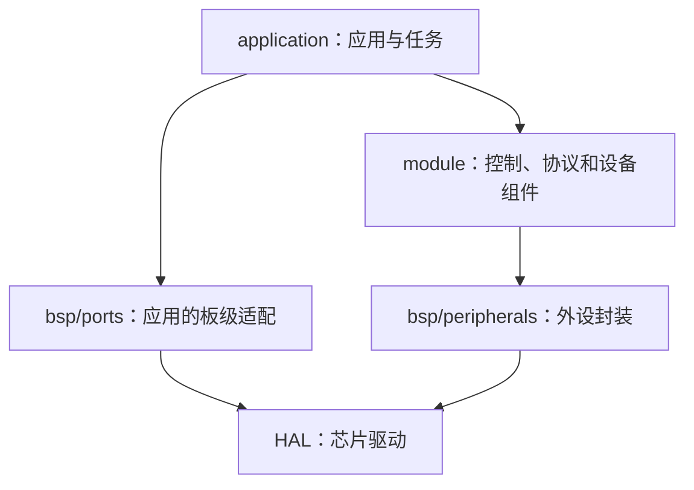

# 01 项目地图：文件在哪里，负责什么

[返回文档目录](../README.md) · 下一步：[启动过程](02-startup.md)

本工程分三层。应用决定行为，组件提供能力，板级代码连接硬件。旧模块仍有历史依赖，新增代码按这条方向组织。

## 你最常打开的应用层

| 位置 | 内容 | 何时看 |
| --- | --- | --- |
| [application/friction](../../application/friction/README.md) | 当前三摩擦轮入口、控制、输入、配置和诊断 | 学摩擦轮 |
| [application/gimbal](../../application/gimbal/README.md) | 当前独立云台入口、执行控制、IMU 和诊断 | 学云台 |
| [application/commands](../../application/commands/README.md) | 把遥控数据转换成内部命令；云台命令仲裁 | 理解输入的含义 |
| [application/services](../../application/services/README.md) | 两套应用使用的诊断、参数和运行记录 | 理解公共功能 |
| [application/legacy](../../application/legacy/README.md) | 旧哨兵、步兵、底盘、双云台和供弹业务 | 研究旧整机方案 |
| [bench_features.h](../../application/bench_features.h) | 独立应用的模块开关 | 选择编译功能 |

应用内，根目录的 `robot.c` 是初始化入口，`robot_task.c` 安排循环；`control/` 放控制核心，`config/` 放配置。摩擦轮的 `input/` 接收电脑/遥控请求，`diagnostics/` 负责显示状态；云台另有 `imu/`。

## 往下一层找工具

| 位置 | 解决的问题 |
| --- | --- |
| `module/control/` | 速度、角度、到位判断、控制权等可移植逻辑 |
| `module/algorithm/` | 现有 PID、滤波、数学和 CRC 实现 |
| `module/protocol/` | DBUS、达妙速度帧、VOFA、文本控制台、裁判等协议 |
| `module/sensor/` | BMI088、姿态、采样数据；旧 IMU 实现有 legacy 前缀 |
| `module/motor/` | DJI、DM、XM 等电机组件及组控制接口 |
| `module/system/` | 参数存储核心、事件历史、周期统计、消息中心、离线监控 |
| `module/device/` | 蜂鸣器、超级电容等设备组件 |
| `bsp/ports/` | 云台、IMU、遥控、USB、时钟/临界区的具体板级适配 |
| `bsp/peripherals/` | CAN、UART、SPI、GPIO 等通用外设封装 |
| `bsp/board/` | 板卡状态观测 |

组件接口说明分别在 [module](../../module/README.md) 和 [bsp](../../bsp/README.md)。

## 其他根目录项

| 名字 | 含义 |
| --- | --- |
| `Core/` | Cube 生成的外设初始化、中断入口和 `main()` |
| `Drivers/` | STM32 HAL、CMSIS 等厂商代码 |
| `Middlewares/` | FreeRTOS、USB 协议栈、RTT 等依赖 |
| `USB_DEVICE/` | USB 设备配置与回调 |
| `tests/` | 电脑上可运行的回归测试 |
| `tools/` | 在电脑上使用的辅助脚本 |
| `build_scripts/` | 固件构建规则；通常先用根目录 Makefile |
| `build/` | 自动生成的 `.o/.elf/.hex/.bin`，编译后出现 |
| `.ioc` / `.ld` / 启动 `.s` | CubeMX 配置 / 存储布局 / CPU 启动汇编 |

目录名表示职责。运行顺序要看函数调用和任务注册，不能靠目录上下排列判断。
